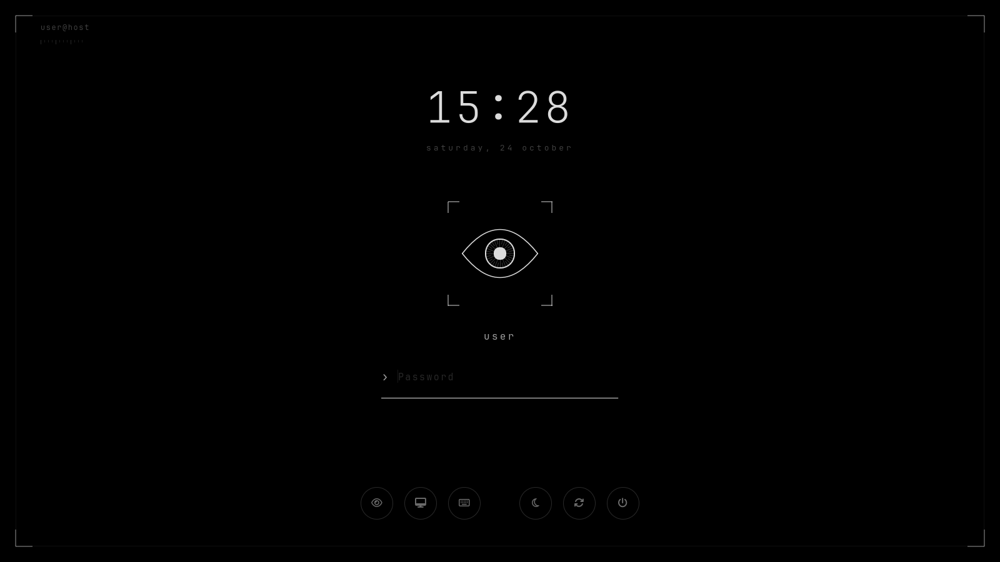
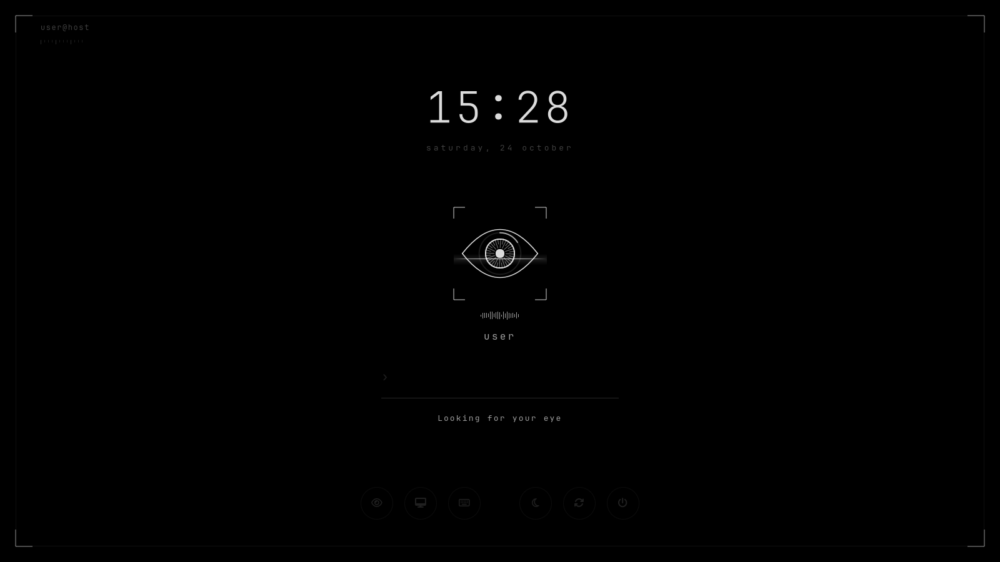
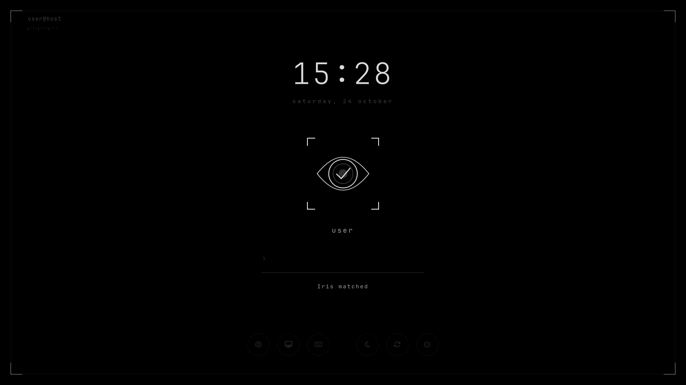
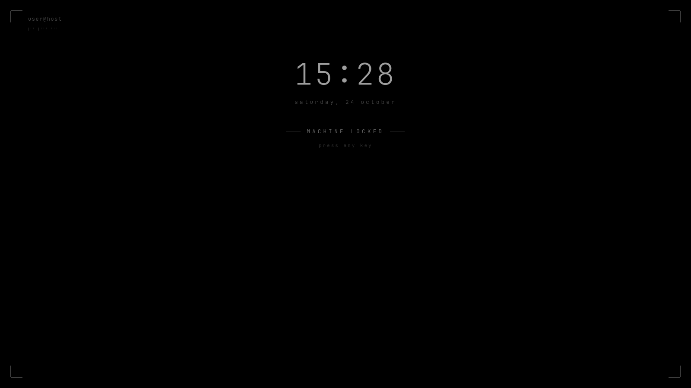
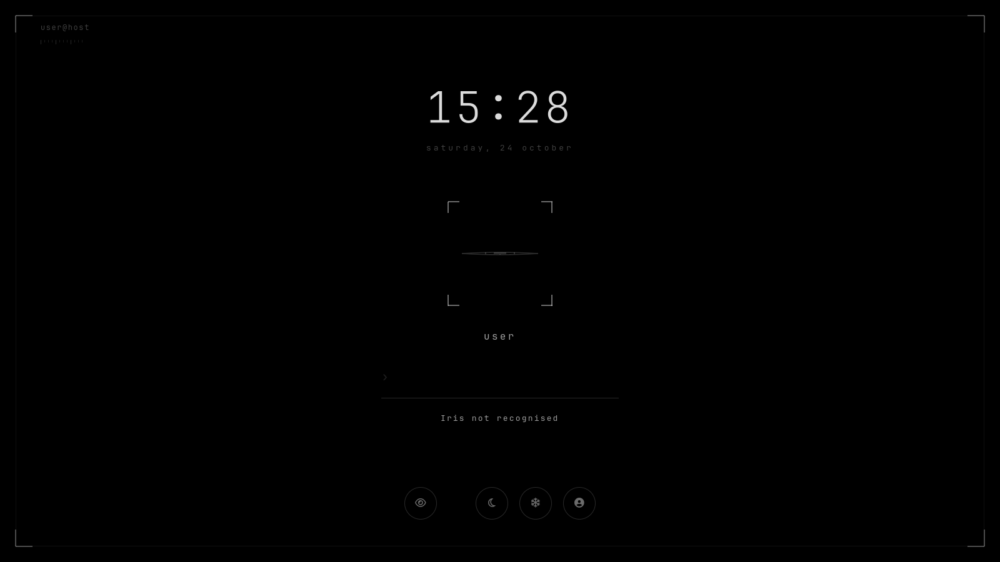

# iris-greeter

**English** · [Türkçe](README.tr.md)

A pitch-black SDDM login screen, Plasma 6 lock screen and start-up splash,
built around an iris-scanner animation. The ground is pure `#000000` (made for
OLED panels) and everything on top of it is a single white at a few opacities.



> **A note before you start:** iris-greeter was originally built for my own setup and daily use, and later shared in case it helps someone else. It reflects my own hardware, tools and preferences, so it may not fit every system or workflow. Issues and suggestions are welcome, but please keep that in mind.

The eye in the middle stands in for the avatar. It blinks while idle and, if
[howdy](https://github.com/boltgolt/howdy) face authentication is set up, it
animates while `pam_howdy` scans and shows what PAM reported.

| Scanning | Matched |
|---|---|
|  |  |

| Lock screen, resting | Lock screen, not recognised |
|---|---|
|  |  |

## What is included

| Part | Installed to | Notes |
|---|---|---|
| SDDM theme | `/usr/share/sddm/themes/iris` | login screen |
| Plasma shell package | `/usr/share/plasma/shells/iris` | lock screen (opt-in, see below) |
| Wallpaper plugin | `~/.local/share/plasma/wallpapers/org.lckt0.iris` | same backdrop under the stock lock screen |
| Splash | `~/.local/share/plasma/look-and-feel/org.lckt0.iris` | start-up splash only, not a global theme |

The login and lock screens share the same QML components (`shared/`), so the
clock, scanner, password field and footer sit in the same place on both.

## Installation

### Requirements

- KDE Plasma 6 and SDDM with the Qt 6 greeter (`sddm-greeter-qt6`)
- [JetBrainsMono Nerd Font](https://www.nerdfonts.com/) installed system-wide
  (for example under `/usr/local/share/fonts`), so the `sddm` user can read it
- Optional: howdy for face unlock. Without it the theme works as a normal
  password prompt.

The theme hard-codes its palette and draws its glyphs from the font, so it does
not depend on any colour scheme or icon theme in your home directory.

### Arch Linux

There is no AUR package yet. Install the font and run the install script:

```sh
sudo pacman -S --needed ttf-jetbrains-mono-nerd
git clone https://github.com/lckt0/iris-greeter.git
cd iris-greeter
./install.sh
```

### Install script

```sh
./install.sh                  # install everything and select login screen, lock backdrop and splash
./install.sh --sddm           # login screen only
./install.sh --lock           # lock screen files only
./install.sh --no-select      # install the files, keep the current selections
./install.sh --no-splash      # leave the start-up splash alone
./install.sh --activate-lock  # also switch the lock screen to the iris shell package
```

The script uses `sudo` for the system directories. It first runs
`tools/check.sh` (lint plus offscreen test runs), then verifies the installed
SDDM theme with the real greeter on the offscreen platform before selecting
it. It records the previous selections in
`~/.local/share/iris-greeter/previous.conf` so `uninstall.sh` can restore them.

The text in the top-left corner defaults to `user@hostname`; override it with
`IRIS_CAPTION="..." ./install.sh`.

What a plain install changes besides copying the packages:

```
/etc/sddm.conf.d/kde_settings.conf   [Theme] Current=iris
~/.config/kscreenlockerrc            [Greeter] WallpaperPlugin=org.lckt0.iris (+ caption)
~/.config/ksplashrc                  [KSplash] Theme=org.lckt0.iris
```

### Manual installation

```sh
sudo install -d /usr/share/sddm/themes/iris
sudo install -m644 sddm/*.qml sddm/metadata.desktop sddm/theme.conf sddm/preview.png /usr/share/sddm/themes/iris/

sudo install -d /usr/share/plasma/shells/iris/contents/lockscreen
sudo install -m644 lockscreen/metadata.json /usr/share/plasma/shells/iris/
sudo install -m644 lockscreen/contents/lockscreen/*.qml lockscreen/contents/lockscreen/qmldir \
    lockscreen/contents/lockscreen/config.xml /usr/share/plasma/shells/iris/contents/lockscreen/

mkdir -p ~/.local/share/plasma/wallpapers/org.lckt0.iris ~/.local/share/plasma/look-and-feel/org.lckt0.iris
cp -rL wallpaper/. ~/.local/share/plasma/wallpapers/org.lckt0.iris/
cp -rL splash/. ~/.local/share/plasma/look-and-feel/org.lckt0.iris/
```

(`install` and `cp -L` follow the symlinks into `shared/`.) Set the caption in
`/usr/share/sddm/themes/iris/theme.conf` and in
`/usr/share/plasma/shells/iris/contents/lockscreen/Caption.qml`.

Then select the pieces:

- **Login screen:** System Settings → Colors & Themes → Login Screen (SDDM) → **iris**,
  or `sudo kwriteconfig6 --file /etc/sddm.conf.d/kde_settings.conf --group Theme --key Current iris`.
- **Lock screen backdrop:** System Settings → Screen Locking → Appearance → wallpaper type **iris**.
- **Splash:** System Settings → Colors & Themes → Splash Screen → **iris**.

### Activating the lock screen

Plasma has no configuration key for the lock screen's QML; on Wayland it is
taken from KWin's `PLASMA_DEFAULT_SHELL` environment variable. With
`--activate-lock` the script writes this systemd user drop-in (or create it by
hand and run `systemctl --user daemon-reload`):

```
~/.config/systemd/user/plasma-kwin_wayland.service.d/iris.conf
    [Service]
    Environment=PLASMA_DEFAULT_SHELL=iris
```

It takes effect at the next login. Only KWin gets the variable, so the desktop
and panel layout are not affected. If the lock screen interface ever fails to
load, `LockScreen.qml` falls back to a minimal password prompt that depends
only on QtQuick. As a last resort, switch to a TTY and run:

```sh
rm ~/.config/systemd/user/plasma-kwin_wayland.service.d/iris.conf
loginctl unlock-session
```

## Uninstallation

```sh
./uninstall.sh              # remove everything and restore the previous selections
./uninstall.sh --lock-only  # only remove the lock screen drop-in
```

`uninstall.sh` removes the lock screen drop-in, switches SDDM, the lock screen
wallpaper and the splash back to what was selected before installing (Breeze,
`org.kde.image` and `org.kde.breeze.desktop` if nothing was recorded), and
deletes the installed packages.

To do the same by hand:

```sh
rm -f ~/.config/systemd/user/plasma-kwin_wayland.service.d/iris.conf
systemctl --user daemon-reload

sudo kwriteconfig6 --file /etc/sddm.conf.d/kde_settings.conf --group Theme --key Current breeze
kwriteconfig6 --file kscreenlockerrc --group Greeter --key WallpaperPlugin org.kde.image
kwriteconfig6 --file ksplashrc --group KSplash --key Theme org.kde.breeze.desktop

sudo rm -rf /usr/share/sddm/themes/iris /usr/share/plasma/shells/iris
rm -rf ~/.local/share/plasma/wallpapers/org.lckt0.iris \
       ~/.local/share/plasma/look-and-feel/org.lckt0.iris \
       ~/.local/share/iris-greeter
```

The login screen changes at the next greeter, the lock screen at the next login.

## howdy notes

- **Login screen:** SDDM sends the password to PAM up front, so a face scan is
  started on request: press Enter on an empty field or click the eye button.
  It is not automatic because a failed scan falls through to `pam_unix` and
  counts as a `pam_faillock` failure.
- **Lock screen:** the scan starts by itself when the screen is woken (any
  key). Moving the mouse does not wake it.
- The progress ring lasts `scanMs` in `shared/Tokens.qml`. Set it to match the
  `[video] timeout` value in `/etc/howdy/config.ini`.
- On-screen messages say "iris" / "eye" instead of "face"; the message table
  is in `shared/ScanStatus.qml`.

## Development

```sh
./tools/check.sh
```

Stages the packages, runs `qmllint`, renders the login and lock screens
offscreen against mocked SDDM / kscreenlocker objects, and runs the lock-screen
key handling tests with `qmltestrunner`. Set `IRIS_SKIP_GREETER=1` to skip the
passes that start the real greeter binaries.

`tools/mock.py` and `tools/mock-lock.py` build the mocks used for the
screenshots above:

```sh
python3 tools/mock.py /tmp/iris-mock file:///tmp/iris-shots
QT_QPA_PLATFORM=offscreen qml6 /tmp/iris-mock/Main.qml
```

Layout:

```
shared/      Tokens, Caption, Backdrop, IrisScanner, ScanStatus,
             PasswordField, GlyphButton
sddm/        Main.qml, theme.conf, metadata.desktop   (symlinks into shared/)
lockscreen/  LockScreen, LockScreenUi, FallbackUi, PasswordSync
wallpaper/   backdrop for the stock lock screen
splash/      start-up splash
tools/       checks, mocks and tests
```

## License

LGPL-2.0-or-later. See [LICENSE](LICENSE).
